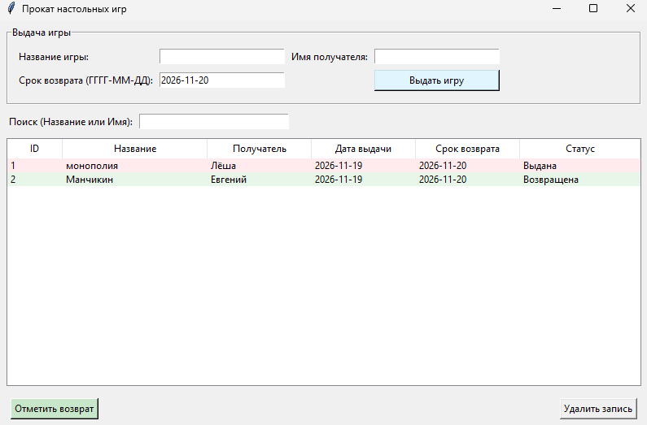

## README.md 

## 🎯 О проекте
### BoardGameRentalApp — простое десктопное приложение на Python для сотрудника клуба настольных игр. Позволяет вести учёт выдачи игр посетителям: фиксировать, кто какую игру взял, на какой срок, а также отмечать возврат и удалять устаревшие записи.

Приложение написано на чистом Python с использованием стандартной библиотеки tkinter — никаких сторонних зависимостей устанавливать не нужно.

## ✨ Возможности
✅ Выдача игры — ввод названия, имени получателя и срока возврата.

🔍 Поиск в реальном времени — фильтрация таблицы по названию или имени получателя без нажатия кнопки «Найти».

🎨 Цветовая индикация — активные выдачи подсвечены красным, возвращённые — зелёным.

↩️ Отметка о возврате — одним кликом меняет статус игры.

🗑️ Удаление записей — с подтверждением, чтобы не удалить лишнее.

📅 Автоподстановка даты — дата выдачи ставится автоматически, срок возврата — с проверкой формата.

🛡️ Валидация ввода — проверка обязательных полей и формата даты (ГГГГ-ММ-ДД).

🖥️ Скриншот интерфейса

⚙️ Установка и запуск
Требования
Python 3.8+ (рекомендуется 3.10+)

Библиотека tkinter (входит в стандартную поставку Python на Windows и macOS; на Linux может потребоваться установка — см. ниже)

Windows / macOS
Скачайте файл board_games.py (или скопируйте код из репозитория).

Откройте терминал (или командную строку) в папке с файлом.

Запустите:

bash
python board_games.py
Linux (Ubuntu / Debian)
Если при запуске появляется ошибка Module
NotFoundError: No module named 'tkinter'
, установите пакет:

bash
sudo apt update
sudo apt install python3-tk
Затем запустите:

bash
python3 board_games.py
## 🚀 Как пользоваться
1. Выдать игру
Введите название игры (например, «Монополия»).

Введите имя получателя (например, «Иван»).

Проверьте срок возврата — по умолчанию подставлена текущая дата. При необходимости измените в формате ГГГГ-ММ-ДД.

Нажмите «Выдать игру» — запись появится в таблице со статусом «Выдана» (красный фон).

2. Найти игру
Начните вводить название или имя получателя в поле «Поиск» — таблица отфильтруется мгновенно, по мере набора.

Очистите поле — таблица покажет все записи.

3. Отметить возврат
Кликните по нужной строке в таблице.

Нажмите «Отметить возврат».

Статус изменится на «Возвращена», строка перекрасится в зелёный.

⚠️ Если игра уже возвращена, повторное нажатие выдаст сообщение «Эта игра уже возвращена» — это защита от случайного двойного клика.

4. Удалить запись
Выделите строку в таблице.

Нажмите «Удалить запись».

Подтвердите удаление в диалоговом окне.

🧩 Структура проекта
~~~bash
 board_games.py
 ├── Импорты (tkinter, ttk, messagebox, datetime)
 ├── class BoardGameRentalApp
 │   ├── __init__()            — инициализация окна и данных
 │   ├── setup_ui()            — построение интерфейса
 │   │   ├── Фрейм выдачи игры
 │   │   ├── Фрейм поиска
 │   │   ├── Таблица Treeview
 │   │   └── Кнопки действий
 │   ├── add_game()            — добавление новой выдачи
 │   ├── refresh_table()       — перерисовка таблицы (с фильтром)
 │   ├── filter_table()        — обработчик поиска
 │   ├── get_selected_game()   — получение выбранной записи
 │   ├── return_game()         — отметка о возврате
 │   ├── delete_game()         — удаление записи
 │   └── add_dummy_data()      — инициализация (заглушка)
 └── Точка входа (if __name__ == "__main__")
~~~
## 🗂️ Модель данных
Каждая запись хранится в памяти как список из 6 элементов:

Индекс	Поле	Пример
[0]	ID (уникальный)	1
[1]	Название игры	"Монополия"
[2]	Имя получателя	"Лёша"
[3]	Дата выдачи	"2026-11-19"
[4]	Срок возврата	"2026-11-20"
[5]	Статус	"Выдана" / "Возвращена"
Все записи хранятся в списке self.games. Поле self.next_id отвечает за генерацию уникальных идентификаторов.

## ⚠️ Ограничения текущей версии
❌ Нет сохранения данных — при закрытии окна все записи исчезают. Для постоянного хранения нужна интеграция с файлом (JSON/CSV) или базой данных (SQLite).

❌ Нет проверки просрочки — приложение не подсвечивает игры, срок возврата которых уже прошёл.

❌ Нет авторизации — любой пользователь может удалить любую запись.

❌ Только один пользователь — нет многопользовательского режима.